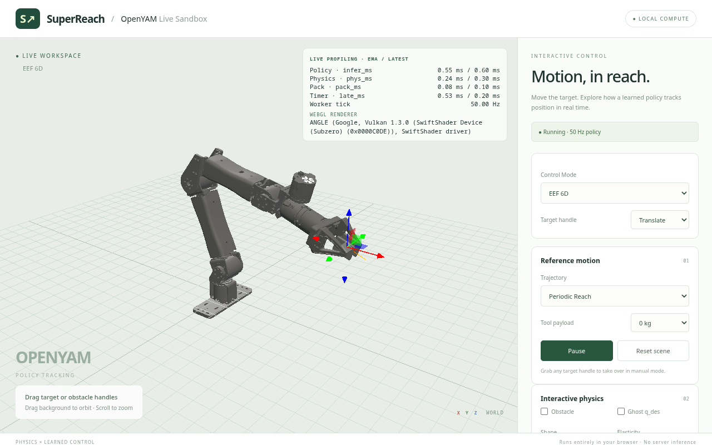

# SuperReach

SuperReach is a learned 50 Hz controller for tracking arm goals on OpenYAM in simulation.

[Live Demo](https://huggingface.co/spaces/playercc7/superreach) (requires Space access) · [Training Dataset](https://huggingface.co/datasets/playercc7/superreach-data)



## Key highlights

- One 50 Hz policy tracks **EEF 6D** (position and orientation), **XYZ-only** (position), or **Joint 6D** (joint angles).
- The policy sends six absolute joint positions, `q_des`, directly to the simulator's position actuators without an output clamp, an interpolator, or external inverse kinematics.
- Training accounts for sensor bias, noise, and command delays from 0 to 10 ms. The browser demo supports simulated payloads from 0 to 2 kg.
- The browser runs policy inference in JavaScript and physics in MuJoCo WASM, with no inference backend.

## Model architecture


Separate Cartesian and joint encoders handle the goal inputs. A history encoder reads 16 ticks of measured joint positions, velocities, and prior commands. The shared decoder combines the history and goal encodings to produce `q_des`.

## Quickstart

Use Python 3.12 and follow [artifact setup](docs/artifacts.md) to set `ARTIFACTS` and `SCENE`. The checkout contains source only; the browser uses separately supplied pinned weights.

```sh
python -m venv .venv
. .venv/bin/activate
python -m pip install -r requirements.txt
python tools/build_web.py --artifacts "$ARTIFACTS" --output build/demo
python -m http.server 8000 --bind 127.0.0.1 --directory build/demo
```

Open `http://127.0.0.1:8000` for the demo. To train, evaluate, and export a small CPU run:

```sh
export CUDA_VISIBLE_DEVICES=
python -m superreach.train --scene "$SCENE" --updates 2 --output run/actor.pt
python -m superreach.evaluate --scene "$SCENE" --checkpoint run/actor.pt --output run/eval.json
python -m superreach.export --scene "$SCENE" --checkpoint run/actor.pt --output run/actor.onnx
```

## GPU reproduction

Install the [GPU requirements and mjlab](docs/gpu-training.md), then run:

```sh
python scripts/download_artifacts.py
python gpu_train/run_train.py --data-dir ./data --out-dir ./runs/tri_mode
```

The GPU trainer starts from scratch. See [data generation](data_gen/README.md) to regenerate the trajectory bank and payload catalog.

## Repository layout

- [`superreach/`](superreach/): policy, training, evaluation, and export.
- [`web/`](web/) and [`tools/`](tools/): browser simulator and build tools.
- [`tests/`](tests/) and [`docs/`](docs/): smoke tests and setup notes.

## License & notice

[Apache-2.0](LICENSE). See [NOTICE](NOTICE) for third-party credits. The controller is for simulation.
