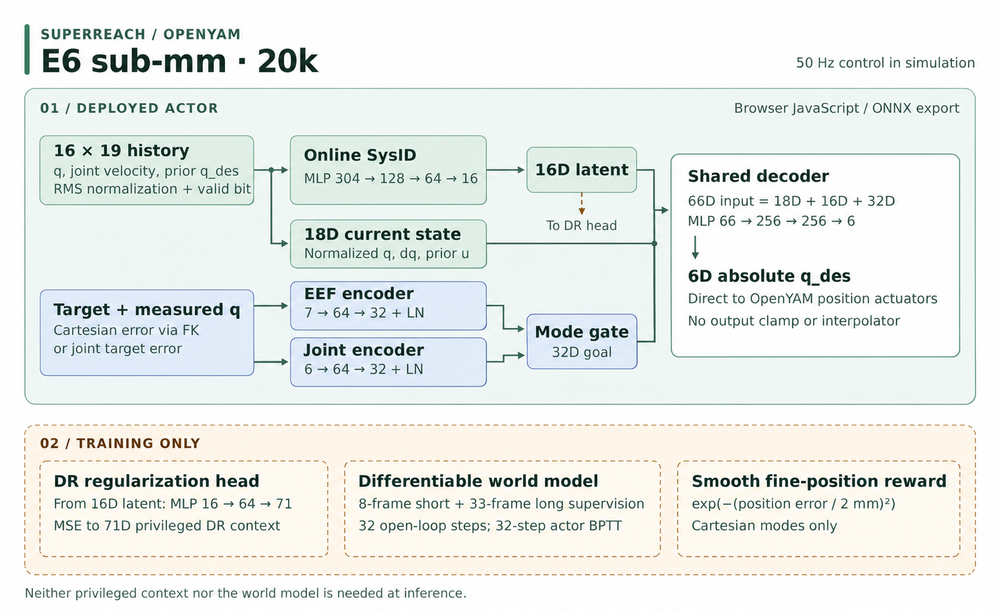

# SuperReach

SuperReach is a learned 50 Hz controller for tracking arm goals on OpenYAM in simulation.

[Live Demo](https://huggingface.co/spaces/playercc7/superreach) · [Training Dataset](https://huggingface.co/datasets/playercc7/superreach-data) · [Evaluation](docs/evaluation.md)


## Key highlights

- One 50 Hz policy tracks **EEF 6D** (position and orientation), **XYZ-only** (position), or **Joint 6D** (joint angles).
- The policy sends six absolute joint positions, `q_des`, directly to the simulator's position actuators without an output clamp, an interpolator, or external inverse kinematics.
- The browser runs `e6-submm@20k` in JavaScript with MuJoCo WASM, no inference server, and simulated payloads from 0 to 2 kg.
- In clean native MuJoCo HOME holds, mean tool-center-point (TCP) error after the first second was **0.72 mm** for EEF 6D and **0.38 mm** for XYZ-only. These stationary results cover four payloads per mode. The evaluator recorded **0 physical failures across 129 case/mode runs**. See the [evaluation protocol and raw results](docs/evaluation.md); these are simulation results, not hardware validation or moving-target error bounds.

## Model architecture



- **Online system identification (SysID):** A 16-tick history holds measured joint positions and velocities, previous issued commands, and a validity bit (`16 × 19`). The history encoder maps it to a **16D latent**. A training-only auxiliary head regularizes this latent by predicting **71D** of privileged domain-randomization (DR) context: payload inertial properties, link and actuator dynamics, and command delay. Neither the head nor its targets are used at inference.
- **Goal conditioning:** The Cartesian encoder uses forward kinematics to compute the 7D input `[position error / 0.5, rotation error / π, rotation mask]`. XYZ-only zeros the rotation error. The joint encoder takes six joint-angle errors divided by π. Both encoders use a 64-unit hidden layer and produce layer-normalized **32D** embeddings. The mode selects one; the shared decoder takes **66D** (18D of normalized current joint state and previous command, 16D SysID, 32D goal) and outputs six absolute `q_des` positions at 50 Hz.
- **Training:** The differentiable world model uses **8-frame** short-window supervision plus **33-frame** long-window supervision (one initial frame and 32 open-loop steps), matching the policy's 32-step training rollout. A smooth Cartesian fine-position bonus, `exp(−(position error / 2 mm)²)`, rewards small errors without a hard 2 mm cutoff. Training also includes sensor bias, noise, and 0–10 ms command delay.

## Quickstart

Use Python 3.12 and follow [artifact setup](docs/artifacts.md) to set `ARTIFACTS` and `SCENE`. The checkout contains source only; the browser uses separately supplied pinned weights.

```sh
python -m venv .venv
. .venv/bin/activate
python -m pip install -r requirements.txt
python tools/build_web.py --artifacts "$ARTIFACTS" --output build/demo
python -m http.server 8000 --bind 127.0.0.1 --directory build/demo
```

Open `http://127.0.0.1:8000` for the demo. To train, evaluate, and export a small CPU run:

```sh
export CUDA_VISIBLE_DEVICES=
python -m superreach.train --scene "$SCENE" --updates 2 --output run/actor.pt
python -m superreach.evaluate --scene "$SCENE" --checkpoint run/actor.pt --output run/eval.json
python -m superreach.export --scene "$SCENE" --checkpoint run/actor.pt --output run/actor.onnx
```

## GPU reproduction

Install the [GPU requirements and mjlab](docs/gpu-training.md), then run:

```sh
python scripts/download_artifacts.py
python gpu_train/run_train.py --data-dir ./data --out-dir ./runs/tri_mode
```

The GPU trainer starts from scratch. See [data generation](data_gen/README.md) to regenerate the trajectory bank and payload catalog, or [Adapt to a New Arm](docs/adapt-to-a-new-arm.md) to port the pipeline.

## Repository layout

- [`superreach/`](superreach/): policy, training, evaluation, and export.
- [`web/`](web/) and [`tools/`](tools/): browser simulator and build tools.
- [`tests/`](tests/) and [`docs/`](docs/): smoke tests and setup notes.

## Acknowledgements

- [SuperMimic](https://supermimic.github.io/) informed the GPU training architecture: a differentiable world model and backpropagation through time for policy updates. The GPU learner also incorporates components credited to ETH Zurich and Chong Zhang in [NOTICE](NOTICE).
- [PolicyIK](https://tinaliu0123.github.io/PolicyIK/) inspired SuperReach's formulation of end-effector tracking as policy-based inverse kinematics.

## License & notice

[Apache-2.0](LICENSE). See [NOTICE](NOTICE) for third-party credits. The controller is for simulation.
